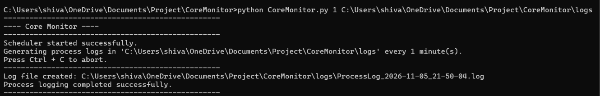
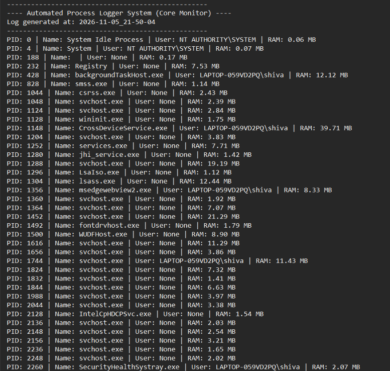

# CoreMonitor


An automated process logging and scheduling system built with Python. It periodically scans active system processes and generates timestamp-based log files detailing process IDs, names, user execution, and RAM consumption.

## Features

- **Process Surveillance:** Utilizes `psutil` to fetch real-time memory usage (in MB) and execution details for all active processes.
- **Automated Scheduling:** Periodically triggers process scans based on user-defined time intervals.
- **Dynamic File Management:** Automatically handles directory creation and maintains cleanly structured, timestamped `.log` records.
- **CLI Utility:** Fully operable via the command line with built-in `--h` (help) and `--u` (usage) flags.

## Demo

### System Execution


### Generated Process Log


## Project Structure

```text
CoreMonitor/
│
├── CoreMonitor.py
├── requirements.txt
├── .gitignore
├── README.md
├── LICENSE
└── screenshots/
    ├── Screenshot 2026-11-05 215019.png
    └── Screenshot 2026-11-05 215132.png